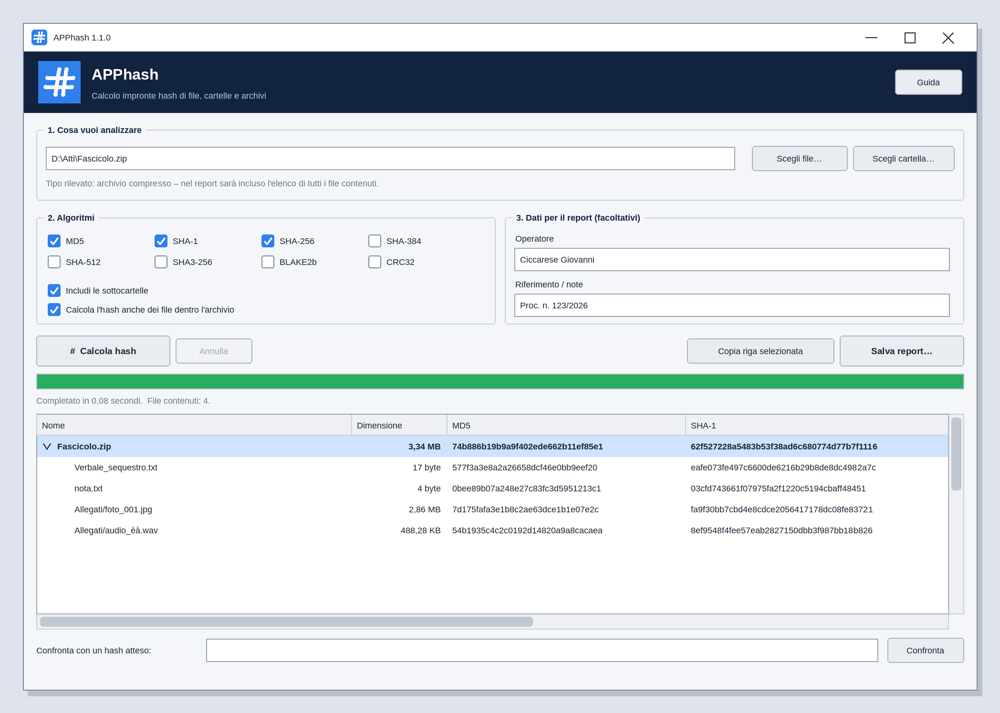
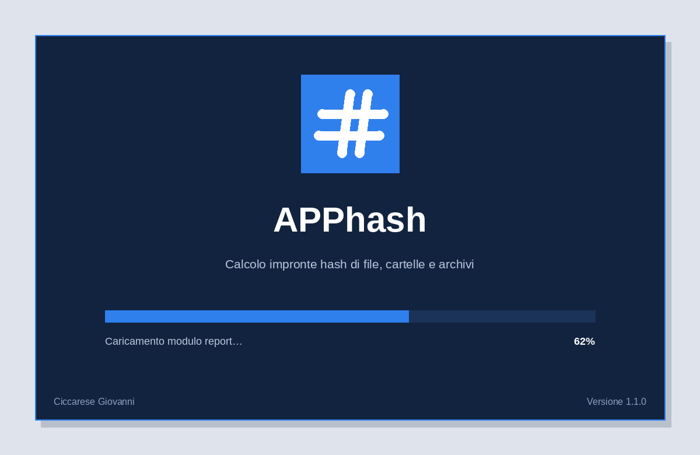
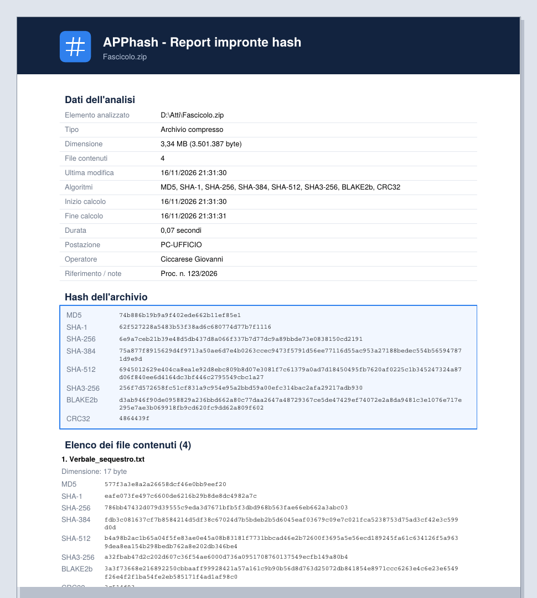

# APPhash

[](https://github.com/gcblack1984/APPhash/actions/workflows/build.yml)
[](LICENSE)

**APPhash** calcola le impronte hash di un file, di una cartella o di un archivio compresso
e genera un report pronto da stampare o allegare.

> **English summary.** APPhash is a free, open-source Windows desktop tool that computes
> file hashes (MD5, SHA-1, SHA-256, SHA-384, SHA-512, SHA3-256, BLAKE2b, CRC32) of a single
> file, a whole folder or a compressed archive, and produces a PDF, HTML or text report.
> For folders and archives the report lists every contained file. It opens files read-only,
> works fully offline and never sends data anywhere. Portable: no installation required.



## Cosa fa

- Calcola in un solo passaggio più algoritmi: MD5, SHA-1, SHA-256, SHA-384, SHA-512,
  SHA3-256, BLAKE2b, CRC32.
- Analizza **file singoli**, **cartelle** (anche con le sottocartelle) e **archivi compressi**.
- Per cartelle e archivi il report contiene l'**elenco di tutti i file contenuti**, con
  dimensione e hash di ciascuno.
- Confronta gli hash calcolati con un hash atteso.
- Salva il report in **PDF**, **HTML** o **testo**.
- Apre i file in sola lettura, funziona senza connessione e non invia dati all'esterno.

| Formato archivio | Elenco dei file contenuti | Hash dei singoli file |
|---|---|---|
| ZIP | Sì | Sì (esclusi i file protetti da password) |
| TAR, TAR.GZ, TAR.BZ2, TAR.XZ | Sì | Sì |
| 7Z | Sì, con nomi e dimensioni | No |
| RAR | No | No |

L'hash dell'archivio nel suo insieme viene sempre calcolato.

## Download

Scarica l'ultima versione dalla pagina [Releases](https://github.com/gcblack1984/APPhash/releases):
il file `APPhash-vX.Y.Z-windows-x64.zip`.

1. Estrai lo zip dove preferisci (anche su chiavetta USB).
2. Apri la cartella `APPhash` e fai doppio clic su `APPhash.exe`.

La cartella `_internal` contiene i componenti necessari al programma e deve restare accanto
all'eseguibile. Requisiti: Windows 10 o 11 a 64 bit.

**Disinstallazione:** APPhash non si installa e non modifica il sistema. Per rimuoverlo basta
eliminare la cartella.

Ogni release include il file `SHA256SUMS.txt` per verificare l'integrità dello zip scaricato.

## Guida

La [guida all'uso in PDF](docs/Guida_APPhash.pdf) è inclusa anche nello zip ed è richiamabile
dal pulsante **Guida** del programma.

| Avvio | Report PDF |
|---|---|
|  |  |

Le immagini sono illustrazioni dell'interfaccia.

## Code signing policy

Free code signing provided by [SignPath.io](https://about.signpath.io), certificate by
[SignPath Foundation](https://signpath.org).

Ruoli del team, modalità di rilascio e informativa sulla privacy sono descritti in
[CODE_SIGNING_POLICY.md](CODE_SIGNING_POLICY.md).

## Privacy

APPhash non trasmette alcuna informazione ad altri sistemi in rete: lavora interamente sul
computer dell'utente, non raccoglie dati e non contiene telemetria.

## Compilare dai sorgenti

Serve [Python](https://www.python.org/downloads/) 3.10 o successivo su Windows.

```bat
crea_eseguibile.bat
```

Lo script installa le dipendenze ed esegue PyInstaller con `APPhash.spec`. Il risultato è la
cartella `dist\APPhash`.

Per eseguire il programma direttamente dai sorgenti:

```bat
py -m pip install -r requirements.txt
py apphash.py
```

Per eseguire i test:

```bat
py -m unittest discover -s tests -v
```

Le release pubblicate sono compilate esclusivamente da GitHub Actions
([build.yml](.github/workflows/build.yml)) a partire da un tag `vX.Y.Z`.

## Licenza

Distribuito con licenza [MIT](LICENSE). Le licenze dei componenti di terze parti inclusi
nell'eseguibile sono elencate in [THIRD_PARTY_LICENSES.md](THIRD_PARTY_LICENSES.md).

## Autore

Giovanni Ciccarese – [@gcblack1984](https://github.com/gcblack1984)
